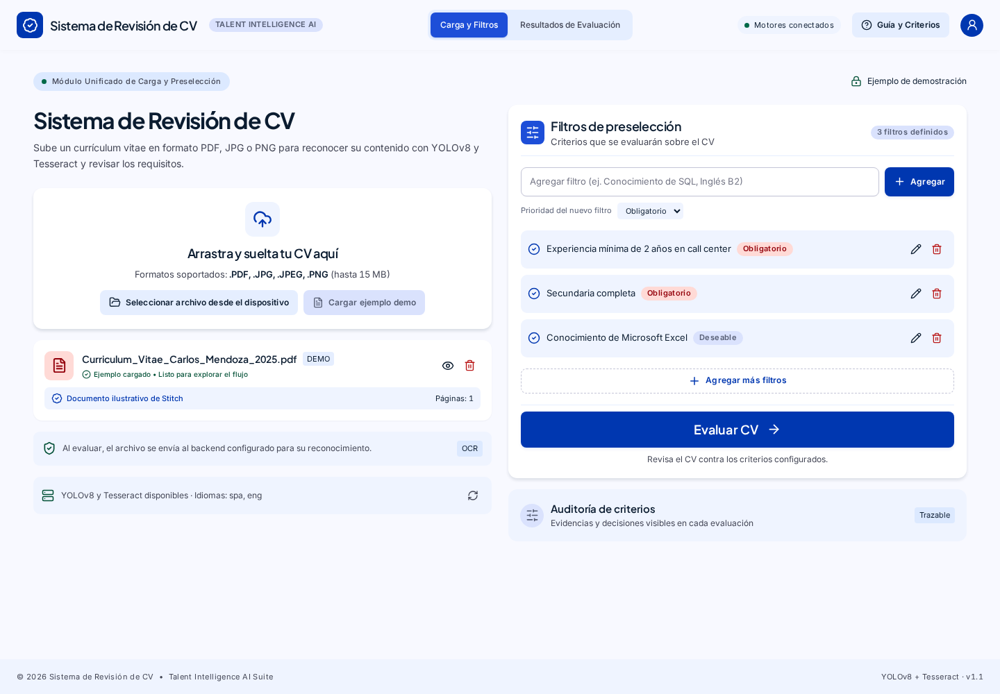
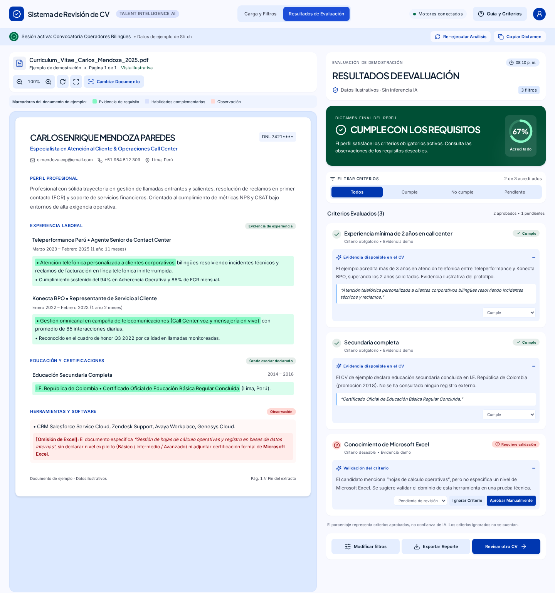
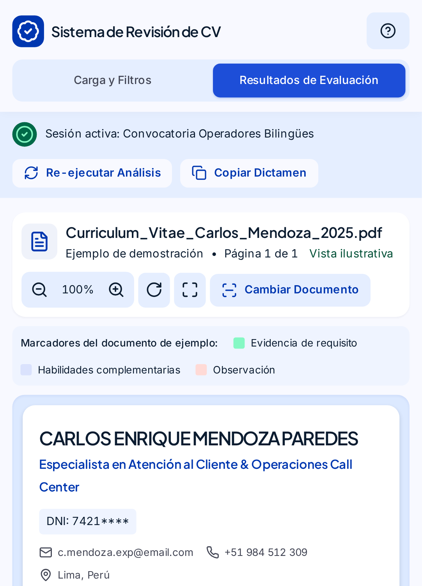

# Sistema de Reconocimiento y Evaluación de CV

Aplicación para analizar currículums en PDF o imagen (PNG/JPG) y apoyar una revisión de requisitos. Combina **visión por computadora (YOLOv8)** para detectar bloques del documento con **OCR (Tesseract)** para extraer el texto, y lo expone mediante una **API FastAPI** con un frontend en **React**.

El reconocimiento es real: no usa coordenadas fijas ni plantillas. El sistema detecta bloques (títulos, párrafos, listas, tablas, imágenes), reconstruye el orden de lectura en documentos de una o varias columnas, y devuelve texto, secciones, datos de contacto y evidencias enlazadas a su posición en el documento.

> Los dictámenes de los requisitos son **manuales**. Reconocer una mención no acredita años de experiencia, títulos ni nivel de dominio.

## Arquitectura

```text
┌──────────────┐      multipart/form-data      ┌──────────────────────┐
│  Frontend    │ ────────────────────────────► │  Backend (FastAPI)   │
│  React 19    │ ◄──────────────────────────── │                      │
│  Vite + TS   │        AnalysisResult         │  PDF/IMG → render    │
└──────────────┘                               │  → YOLOv8 (bloques)  │
                                               │  → Tesseract (OCR)   │
                                               │  → orden de lectura  │
                                               │  → extracción        │
                                               └──────────────────────┘
```

## Capturas

| Carga del documento y filtros | Resultados de la evaluación |
| --- | --- |
|  |  |

<p align="center">
  
  <br>
  <sub>Diseño adaptable (vista móvil)</sub>
</p>

## Requisitos

| Componente | Versión |
| --- | --- |
| Python | 3.12 o superior (probado en 3.14) |
| Node.js | 22.12 o superior (ver `frontend/.nvmrc`) |
| Tesseract | 5.x con idiomas `spa`, `eng` y `osd` |

En Debian/Ubuntu el binario de Tesseract se instala con:

```bash
sudo apt install tesseract-ocr tesseract-ocr-spa
```

## Instalación

### 1. Backend

```bash
git clone git@github.com:JUAQUIN06/tesis-ocr-yolov8.git
cd tesis-ocr-yolov8

python3 -m venv venv
source venv/bin/activate
pip install -r requirements.txt

# Descarga el modelo YOLOv8 (DocLayNet) y los idiomas de Tesseract
python backend/scripts/setup_resources.py
python backend/scripts/setup_resources.py --verify
```

### 2. Frontend

```bash
cd frontend
npm ci
```

## Ejecución

**Opción A — ambos servicios a la vez** (desde `frontend/`):

```bash
npm run dev:full
```

**Opción B — por separado:**

```bash
# Terminal 1 (raíz del proyecto)
source venv/bin/activate
python -m uvicorn backend.main:app --host 127.0.0.1 --port 8000
```

```bash
# Terminal 2
cd frontend
npm run dev
```

**Opción C — script incluido** (desde cualquier carpeta):

```bash
./iniciarBackend.sh
```

| Servicio | URL |
| --- | --- |
| Aplicación | http://localhost:5173 |
| API interactiva (Swagger) | http://localhost:8000/docs |
| Estado de motores | http://localhost:8000/api/health |

## Uso rápido de la API

```bash
curl --fail-with-body http://localhost:8000/api/analyze \
  -F 'file=@/ruta/al/curriculum.pdf' \
  -F 'force_ocr=false' \
  -o resultado.json
```

La respuesta incluye `text`, `pages[]` (regiones YOLO y líneas OCR con `bbox`), `profile` (contacto, habilidades, idiomas, secciones) y `warnings`. Cada dato extraído lleva `evidence` con página, línea, texto y caja.

También se puede usar desde Python o consola:

```bash
python -m backend.cli /ruta/cv.pdf --output resultado.json
```

## Estructura del repositorio

```text
tesis-ocr-yolov8/
├── backend/                  # API FastAPI + pipeline OCR/YOLOv8
│   ├── services/             # documentos, detector, ocr, layout, extractor, pipeline
│   ├── scripts/              # instalación verificable de modelo e idiomas
│   ├── tests/                # pruebas unitarias, API e integración real
│   └── README.md             # documentación detallada del backend
├── frontend/                 # SPA React + TypeScript + Vite + Tailwind
│   ├── src/                  # componentes, servicios, hooks, tipos
│   ├── tests/                # Playwright (UI y full-stack)
│   └── README.md             # documentación detallada del frontend
├── dataset/                  # data.yaml y carpetas de imágenes/etiquetas (vacías)
├── entrenamiento/            # scripts de entrenamiento
├── iniciarBackend.sh         # arranque rápido del backend
└── requirements.txt          # dependencias del backend
```

## Recursos que no están en el repositorio

Por tamaño, se excluyen con `.gitignore` y se regeneran localmente:

| Recurso | Cómo obtenerlo |
| --- | --- |
| Entornos virtuales (`venv/`, `backend/.venv/`) | `python -m venv venv && pip install -r requirements.txt` |
| `frontend/node_modules/` | `npm ci` |
| Modelo YOLOv8 (`*.pt`) | `python backend/scripts/setup_resources.py` |
| Idiomas de Tesseract | el mismo script los descarga en `backend/.runtime/` |
| Dataset de imágenes/etiquetas | no versionado; colócalo en `dataset/` |

## Configuración

El backend lee variables `CV_*` (modelo, idiomas, límites, DPI, concurrencia, CORS). El frontend usa `BACKEND_PROXY_TARGET`, `VITE_API_BASE_URL` y `VITE_ANALYSIS_TIMEOUT_MS`. Consulta `backend/.env.example`, `frontend/.env.example` y las tablas completas en [`backend/README.md`](backend/README.md#configuración).

## Pruebas

```bash
# Backend
cd backend
../venv/bin/python -m ruff check .
../venv/bin/python -m pytest -q
../venv/bin/python -m pytest --run-integration -v   # motores reales

# Frontend
cd frontend
npm test                 # unitarias
npm run lint
npx playwright install chromium
npm run test:e2e         # interfaz en escritorio y móvil
npm run test:integration # navegador + backend real
```

## Documentación

- [`backend/README.md`](backend/README.md) — pipeline, contrato de la API, errores y configuración.
- [`frontend/README.md`](frontend/README.md) — funcionalidades, estados de la evaluación y despliegue.
- [`docs/DESPLIEGUE.md`](docs/DESPLIEGUE.md) — frontend en Vercel + backend en equipo propio con túnel de Cloudflare.

## Créditos y licencias

- Modelo de detección: [hantian/yolo-doclaynet](https://huggingface.co/hantian/yolo-doclaynet) (AGPL-3.0 declarada; ver `backend/models/README.md`).
- Idiomas OCR: [tesseract-ocr/tessdata_fast](https://github.com/tesseract-ocr/tessdata_fast) (Apache-2.0).
- YOLOv8: [Ultralytics](https://github.com/ultralytics/ultralytics) (AGPL-3.0).

---

Proyecto de tesis. Los resultados sobre muestras sintéticas verifican el funcionamiento, no miden precisión sobre una colección de CV reales.
